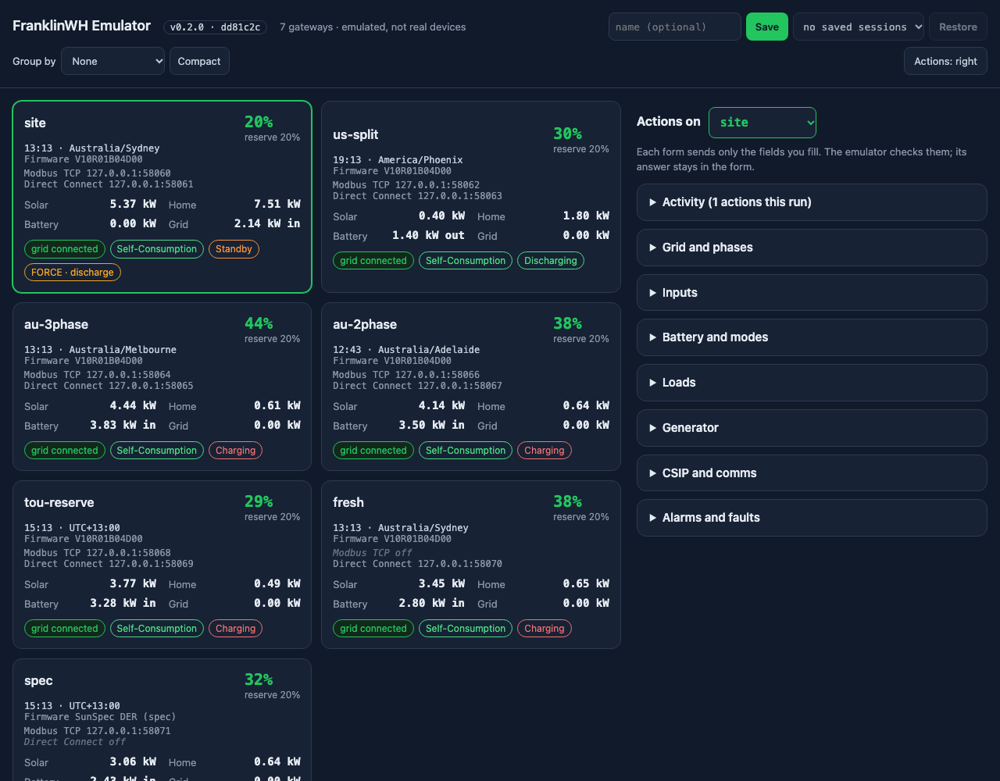

# FranklinWH Gateway Emulator

An emulator of the FranklinWH **aGate** for testing without hardware. It serves the **Direct
Connect** local protocol (TCP/9000) and **Modbus TCP** (SunSpec chain plus FranklinWH extension
registers), both in front of one **closed-loop site model**, so control commands actually move the
battery and both ports always agree. It runs one gateway or a **fleet**, with an optional
[web UI](ui.md).

!!! warning "Unofficial, and an emulation"
    Not affiliated with FranklinWH. It can never be 100% accurate: it may behave differently from
    a real aGate, now or in the future, and may have bugs or omissions a real aGate doesn't.
    Read the [Disclaimer](disclaimer.md) before relying on any result.

## Start here

- [Getting started](getting-started.md): install, run one gateway or a fleet, use it from Python.
- [Configuration](configuration.md): describe each site (aGate, aPowers, PV, grid, accessories, location) in a fleet file.
- [Web UI](ui.md): cards, the energy diagram, actions, TOU editor, sessions, grouping.
- [What is emulated](emulated.md): protocols, firmware profiles, and the choices where sources disagree.

## Reference

- [Grid, grid codes, export limits and phases](grid.md)
- [The site model](site-model.md): TOU, energy, location and time, weather, loads, generator
- [Control API and `ctl`](control-api.md)
- [Scenarios](SCENARIOS.md) and [replaying recorded data](replay.md)
- [Direct Connect](DIRECT_CONNECT.md), [design](DESIGN.md), [calibration](CALIBRATION.md),
  [findings](FINDINGS.md), [weather and loads](WEATHER_AND_LOADS.md)

Built for [franklinwh-modbus](https://github.com/david2069/franklinwh-modbus),
[franklinwh-modbus-bridge](https://github.com/david2069/franklinwh-modbus-bridge) and
[franklinwh-direct-connect-bridge](https://github.com/david2069/franklinwh-direct-connect-bridge).
