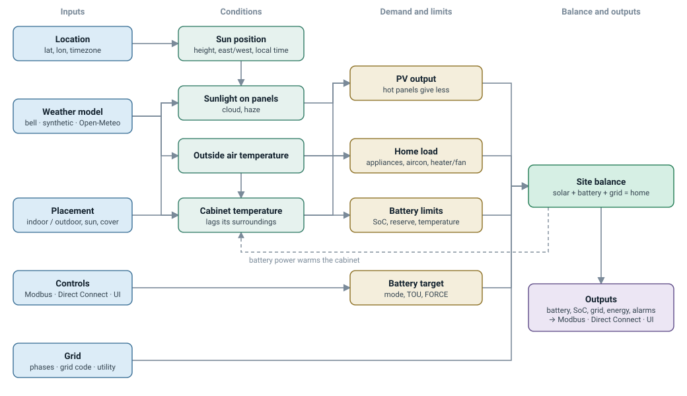

# Model baseline

What each emulated site is made of, what drives it, and where each number comes from. Read with
[What is emulated](emulated.md) (protocols and quirks) and [Configuration](configuration.md)
(every key).

Each value is marked by where it comes from:

- **measured:** read on the reference aGate;
- **documented:** a FranklinWH document or standard;
- **plausible:** a reasonable value nobody has measured, settable per gateway.

## How the inputs drive the model

Every arrow is evaluated at each step of the site clock, which runs in real time, scaled, or
manual in tests. The hardware (how many aPowers, PV inputs, generator, smart circuits) sets the
ratings throughout. The dashed arrow closes the loop: charging and discharging warm the cabinet.
Dashed boxes are planned. The diagram is drawn by `tools/gen_model_flow.py`: edit it there.

## Hardware baseline

### What each emulated site has today

| Part | Emulated | Source |
|---|---|---|
| aGate | "aGate X" (Model 1 `Md`), one per site, of a model (`model.agate`, default by region: [Sources and regions](sources-and-regions.md)); firmware per profile (V10R01B04D00 / V12R02B60D00 Modbus `Vr`; Direct Connect IBG V12R02B30D06 / V12R02B60D00) | measured (reference aGate) |
| aPower | 1–N of one model (`model.apower`), combined into one battery: kWh, kW and charge kW per unit from the model (aPower X: **13.6 kWh, 5 kW**; aPower 2: 15 kWh, 10 kW, charging at 8 kW) | documented (datasheets, PV Curtailment White Paper) and measured (713.WHRtg, aPower X) |
| PV inputs | proximal (aGate) + remote1/remote2 (aPbox), each with a relay | measured (register layout) |
| Generator | on the generator input, AGS by SoC during outages | documented fields (DC 1901), behaviour partly interpreted |
| Smart circuits | SW1–SW3 | measured (names, layout) |
| Grid | single, split or three phase | grid codes: documented (AS/NZS 4777, IEEE 1547, Ausgrid) |

### FranklinWH's products (for later models)

Which FranklinWH documents apply to which region, and the model codes that tell North American
from AU/NZ hardware apart: [Sources and regions](sources-and-regions.md).

From FranklinWH's published warranties (AU & NZ, June 2026; US & CA, Oct 2026) and its
Backwards Compatibility Statement (US V1.1, Oct 2026). **Documented.**

| Product | Capacity / power | Warranty | Capacity retained at end of warranty |
|---|---|---|---|
| aPower X (US APR-05K13V1/V2; AU X-01-AU) | 13.6 kWh / 5 kW | 12 y | ≥ 70 % at 12 y or 43 MWh, whichever first |
| aPower X-02-AU (AU) | 15 kWh | 12 y | ≥ 70 % at 12 y or 60 MWh |
| aPower 2 (US) | 15 kWh / 10 kW | 15 y | ≥ 70 % at 15 y or 60 MWh |
| aPower S (US, DC hybrid with PV inputs) | 15 kWh / 11.5 kW | 15 y | ≥ 70 % at 15 y or 60 MWh |
| aGate X 1.0/1.1/1.3/1.3.1 (US), AGT-R1V1-AU | — | 12 y | — |
| MAC 1, aHub (US) | — | 15 y | — |
| Smart Circuits, Generator Module, aPbox, Split CT | — | 12 y | — |
| aGate communications module | — | up to 5 y | — |

The full warranty is reduced to **4 years** if the system isn't registered at installation, or
stays offline for more than 90 days.

| Controller (US) | aPower X | aPower 2 | aPower S | Limits |
|---|---|---|---|---|
| aGate X 1.0/1.1 | yes | yes | no | X only: 15 max; X + 2: 8 max |
| aGate X 1.3/1.3.1 | yes | yes | yes | 15 max, up to 8 aPower S |
| MAC 1 | no | yes | yes | 4 max, 120/240 V |

Model capacity, power and charge power are emulated for every catalogued aPower (#180), and
mixed models on one aGate (`model: {apower: [0, 3]}`, one per aPower, in unit order): capacity,
discharge and charge power add up per unit, Direct Connect 1102 `PE_HW_VER` lists each unit's
code, and the counts above are checked. With mixed models the SoC is still one combined value,
the warranty and SoH follow the first unit's model, and the WSetPct basis is the mean aPower.
**aPower S DC PV** (`dc_pv: {rated_w, export}`, the app's MPPT page): modelled from the
datasheet ratings (4 MPPT inputs, up to 15 kW of DC PV and an 11.5 kW inverter per aPower S),
not from a capture. DC PV follows the site's solar shape (weather, panel temperature, age),
charges the battery directly, and shares the inverter with battery discharge: DC PV beyond the
inverter plus the battery's charging is curtailed, and discharge gives way to it. With
`export: false` it only serves the house and the battery. It is counted in solar (1301 `p_sun`,
502) and is not frequency-curtailed off-grid. The FranklinWH cloud API reports MPPT values
(franklinwh-cloud f18ff8a, `docs/franklinwh_openapi.json`, `models.py`): `getDeviceCompositeInfo`
`runtimeData` `mpptSta`, `mpptAllPower`/`mpptActPower` (kW), `mPanPv1Power`/`mPanPv2Power` (kW),
`mpanPv1Wh`/`mpanPv2Wh`; `solarHaveVo` `mpptEnFlag`, `mpanPv1En`/`mpanPv2En`, `mpptExportEn`;
`getFhpElectricData` `mpptWhArray`; per aPower `mpptAppVer`. The emulator serves Modbus and
Direct Connect, not the cloud API. No aPower S site has been captured on Direct Connect or Modbus.
Not emulated yet: the aPower 2 / aPower X peak-charge window,
MAC 1, aHub, and per-aPower SoC (backlog HARDWARE-TOPOLOGIES).

## The influences

| Influence | Affects | Default | Status | Key |
|---|---|---|---|---|
| Location | sun position, local time and DST, weather data | none: fixed UTC offset, no sun | documented (NOAA sun) | `location` |
| Weather model | irradiance on the array, cloud, ambient | bell curve | Open-Meteo: real data; synthetic: modelled | `weather` |
| PV temperature | PV output: −0.4 %/°C from a 45 °C cell | on | plausible | `pv_temperature` |
| Placement | temperature around the cabinet (room, garage, shed, outdoors with sun and cover) | none: ambient + 8 °C | plausible | `install` |
| Cabinet temperature | battery limits, heater/fan, OVER_TEMP, Modbus `TmpCab` | 1.5 h lag, +3 °C per kW | plausible | `install` |
| Battery temperature limits | charge 0 → 10 °C, discharge −20 → −10 °C, both 45 → 55 °C; heater 300 W < 5 °C, fan 60 W > 40 °C; OVER_TEMP 60/55 °C | on with `install` | plausible | `battery_temperature` |
| Battery losses | charge/discharge efficiency, standby drain | agate-measured | measured | `battery` |
| House loads | home load; aircon/heating follow the outside air | built-in curve | plausible; presets | `loads` |
| Grid code | trips, ride-through, reconnect, volt-watt, frequency-watt | from phases | documented | `grid_code` |
| Grid code's declared export limit | grid export tracked (breaches counted), or enforced with `export_limit_enforced` | Ausgrid: 10 kW single-phase, 5 kW/phase | documented (Ausgrid NS194) | `grid_code`, `export_limit_enforced` |
| Utility rules (utility / DNSP / lines company) | export allowed, limited or prohibited; import limit (stop grid charging, then discharge); no battery export; all enforced, as PCS settings | none | export limits documented; behaviour plausible | `utility` (or `dnsp`, `lines_company`) |
| Service main breaker | the site holds import below it; overload trips it (inverse time, plausible) and the site islands until reset | none | plausible | `service` |
| Direct Connect 1701 install profile | serve and store the PCS fields | — | planned [#123](https://github.com/david2069/franklinwh-gateway-emulator/issues/123) | — |
| Mode, reserves, TOU | battery target | Self-Consumption, 20 % | measured (mode numbers), documented (TOU format) | `native_mode`, `tou_schedule` |

**Home (indoor) temperature isn't modelled.** Aircon and heating appliances respond to the
outside air, and a heated-room placement holds the cabinet near 20 °C.

## Planned

- **Age and warranty** ([#115](https://github.com/david2069/franklinwh-gateway-emulator/issues/115)): SoH from age *and* energy throughput down to the warranty's 70 %; PV ageing; years left.
- **Time machine** ([#116](https://github.com/david2069/franklinwh-gateway-emulator/issues/116)): jump a site years ahead.
- **Region-locked power ratings** ([#113](https://github.com/david2069/franklinwh-gateway-emulator/issues/113)): policy limits, separate from temperature.
- **pvlib** ([#112](https://github.com/david2069/franklinwh-gateway-emulator/issues/112)): an optional PV model.
