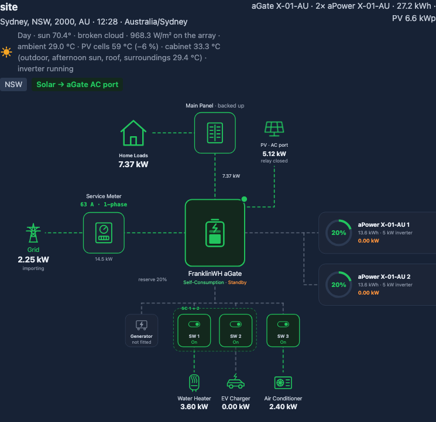
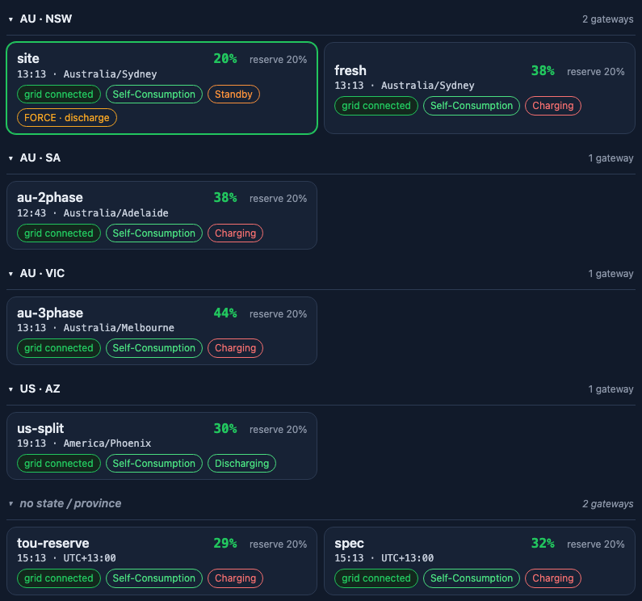
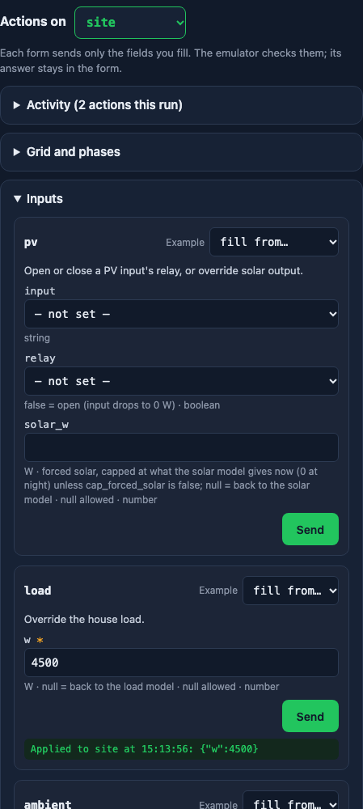
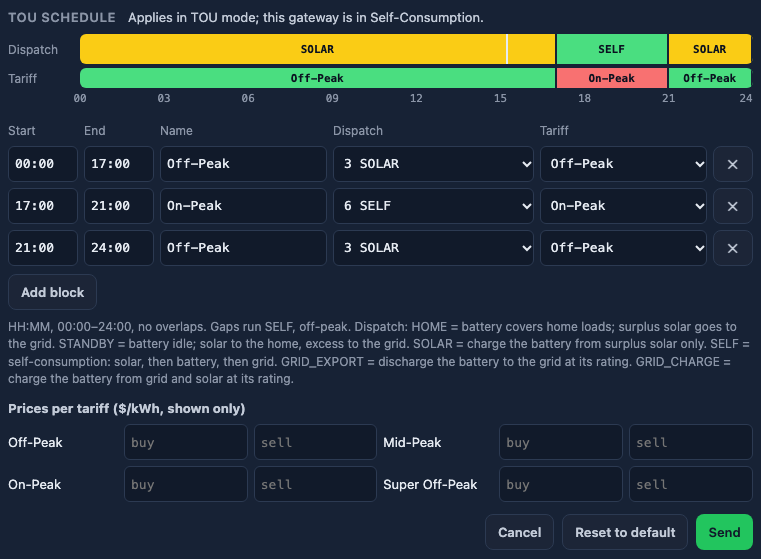

# Web UI

The web UI is optional: the emulator works without it, through Modbus TCP, Direct Connect, the
[control API](control-api.md) and [scenarios](SCENARIOS.md).

```bash
franklinwh-emulator ui examples/fleet.yaml        # then open http://127.0.0.1:8502/
```

Checks the fleet file first (every problem is printed, and it exits 2), starts the fleet, and
serves a page with one card per gateway, refreshed every second: the Modbus TCP Server and
Direct Connect addresses to point a bridge at, SoC, solar, home, battery and grid power, grid
state, mode, battery status, FORCE, alarms and injected faults. Selecting a card shows its live energy diagram
(grid, meter, aGate, home, PV per input with the aPbox for remote inputs, the battery, generator
and smart circuits, with lines moving in the direction power flows), then its legs, circuits,
appliances and generator. What the emulator doesn't model (per-aPower values, V2L, a non-backup
panel, tariffs and more) is listed under the diagram rather than drawn. Under it, every control action
has a form (built from `GET /schema`, grouped as in SCENARIOS.md); only the fields you fill are
sent, and the emulator's answer (applied, or its error) stays in the form. The control API below
runs on the same port, so `ctl` works unchanged.

**Save and Restore.** Every action applied (page, `ctl`, API or restore) is logged (`GET /log`,
the page's Activity panel). **Save** writes the successful ones, in order, plus each gateway's
SoC, to `emulator-workspace/sessions/<name>.yaml`; after a restart, **Restore** (or
`franklinwh-emulator ui FLEET --restore NAME`) replays them, so the fleet is set up as before.
The page notices a restart or a new version and offers to reload. Loopback only, no login, no
internet. Plan:
[UI plan](UI_PLAN.md); a hands-on walk-through: [testing the UI by hand](UI_TESTING.md).

## The page


Each card shows the gateway's local time and timezone, firmware, the Modbus TCP and Direct
Connect addresses to point a client at, live power, and tags for the grid, mode, battery status,
FORCE (an M704 setpoint), alarms, faults and Debug Mode. Click a card to make it the **active
gateway**; the actions column works on it.

## Energy diagram



Lines move in the direction power flows; idle lines are grey. Below it: grid legs, smart
circuits, appliances, the generator and the TOU schedule.

## Temperature units

The **°C / °F** button in the header switches every temperature on the page (ambient, PV cells,
cabinet, surroundings, battery). It starts in °F for US-region browsers and °C elsewhere, and
is remembered. Only the display changes: the emulator, its state, Modbus TCP and Direct Connect
stay metric, as on the aGate.

## Grouping and compact cards



**Group by** (header) groups cards by country, state/province, suburb/city, postcode or site
ID, from each gateway's `location`; click a group to collapse it. **Compact** shrinks each card
to SoC, local time and tags. Both are remembered by the browser.

## Actions



Every control action has a form, built from `GET /schema`. Only the fields you fill are sent; the
emulator's answer stays in the form. **Activity** lists every action from any source.
**Monitor** (below Activity) shows each gateway's Modbus TCP and Direct Connect clients and
recent refusals, and the process's CPU, memory, threads and loop lag (`GET /monitor`, read
only while the panel is open).

## TOU schedule



Two 24 h bars (dispatch and tariff) with a line at the gateway's local time. **Edit** changes
blocks (start, end, name, dispatch, tariff) and prices; the emulator checks them.

## Modbus TCP and reboot through Direct Connect


A factory aGate starts with Modbus TCP off. **Enable Modbus TCP via Direct Connect** sends a real
Direct Connect 1205 write to the gateway's own port; Modbus TCP opens about 3 s later.
**Reboot via Direct Connect** sends 1721: both ports drop for about 20 s.
