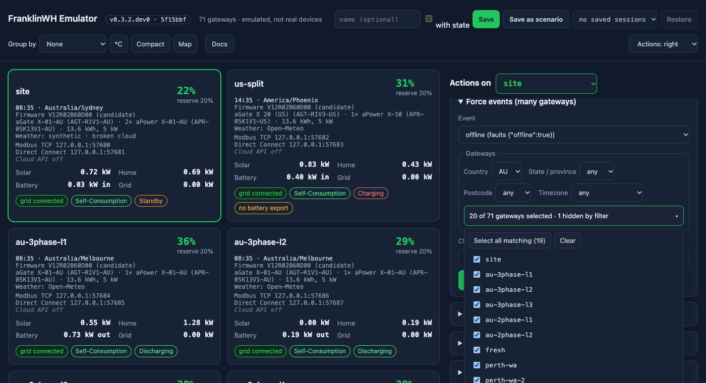
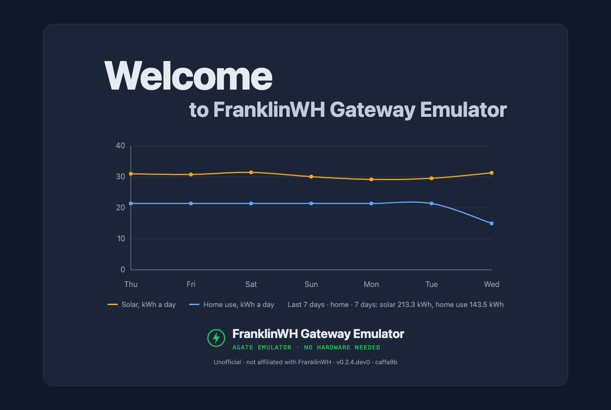
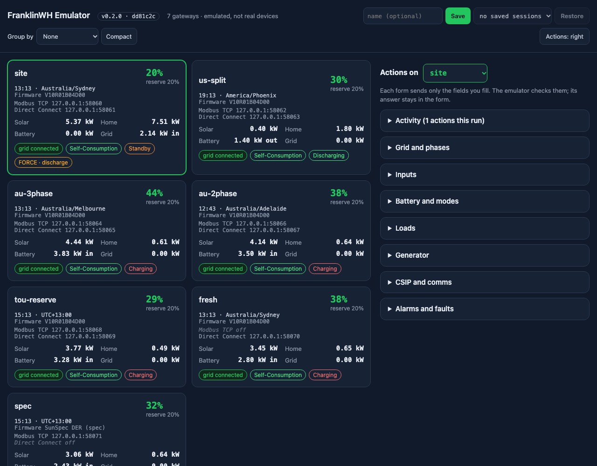
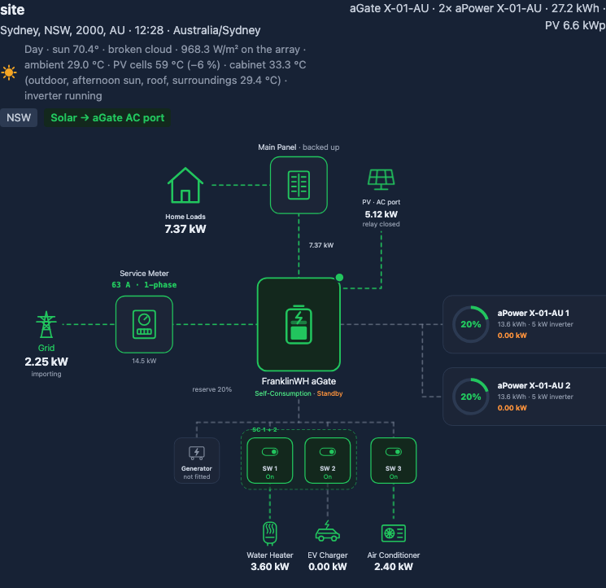
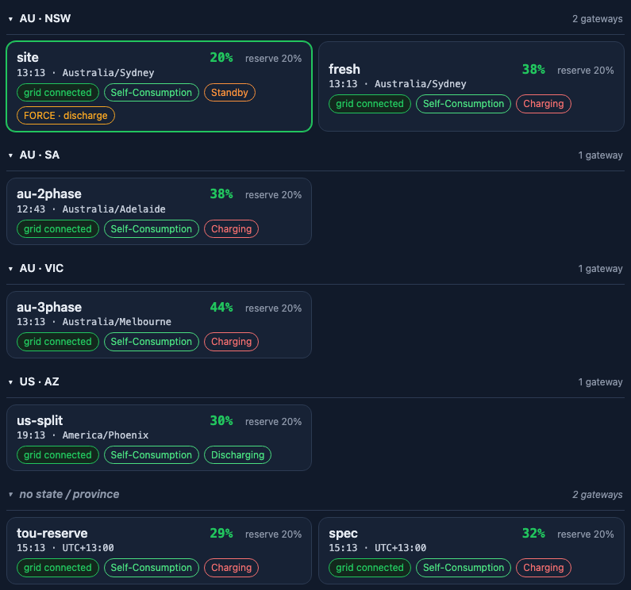
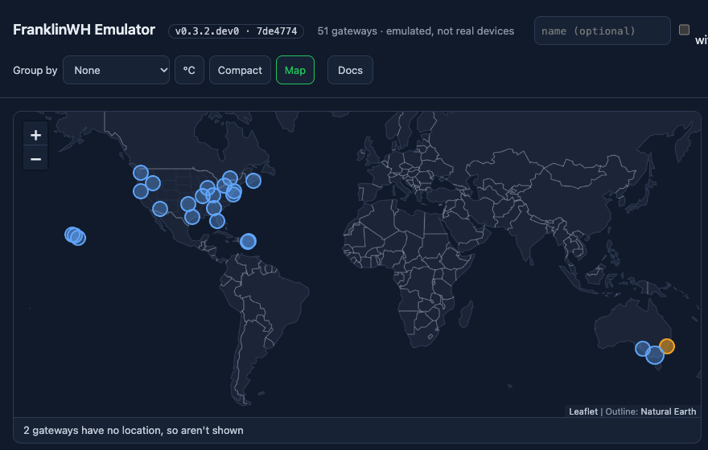
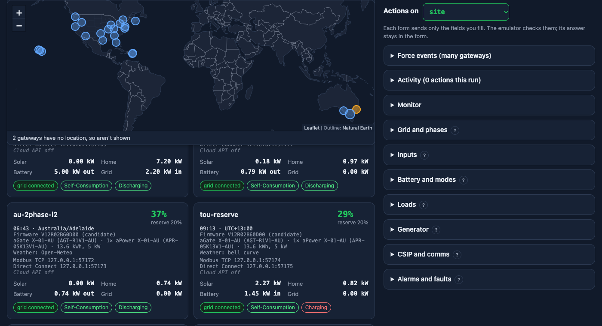
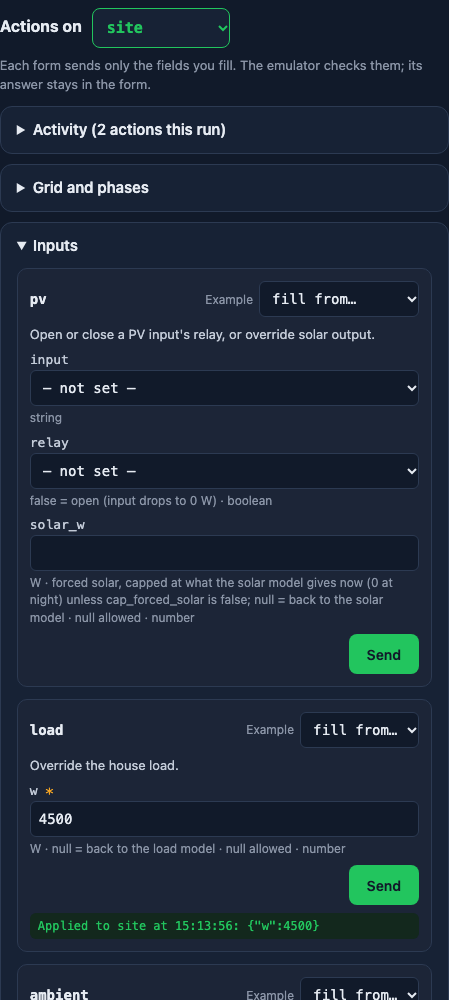
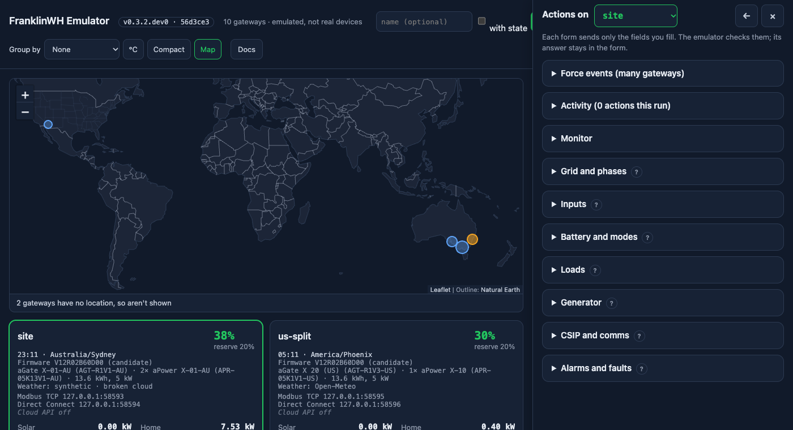
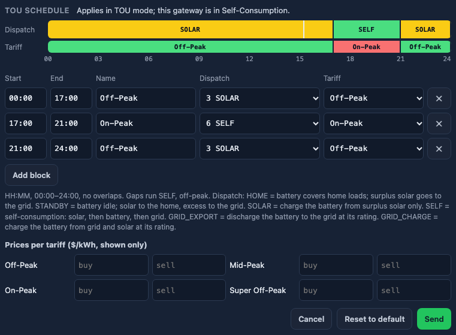

# Web UI

The web UI is optional: the emulator works without it, through Modbus TCP, Direct Connect, the
[control API](control-api.md) and [scenarios](SCENARIOS.md).

```bash
franklinwh-emulator ui examples/fleet.yaml        # then open http://127.0.0.1:8502/
```

Checks the fleet file first (every problem is printed, and it exits 2), starts the fleet, and
serves a page with one card per gateway, refreshed every second: the Modbus TCP Server and
Direct Connect addresses to point a bridge at, SoC, solar, home, battery and grid power, grid
state, mode, battery status, FORCE, alarms and injected faults. Selecting a card shows its live energy diagram
(grid, meter, aGate, home, PV per input with the aPbox for remote inputs, the battery, generator
and smart circuits, with lines moving in the direction power flows), then its legs, circuits,
appliances and generator, and V2L where it is set up (amber while the EV supplies the home).
What the emulator doesn't model (per-aPower values, a non-backup
panel, tariffs and more) is listed under the diagram rather than drawn. Under it, every control action
has a form (built from `GET /schema`, grouped as in SCENARIOS.md); only the fields you fill are
sent, and the emulator's answer (applied, or its error) stays in the form. The control API below
runs on the same port, so `ctl` works unchanged.

**Save and Restore.** Every action applied (page, `ctl`, API or restore) is logged (`GET /log`,
the page's Activity panel). Its `source` is `page` for the page's forms, `api` for `ctl` and other
API clients, and `restore:<name>` for a restore. Form results and Activity show the gateway's
local time, as its card and Events do (`site_time` in the log; `at` is UTC). **Save** writes the successful ones, in order, plus each gateway's
SoC, to `emulator-workspace/sessions/<name>.yaml`; after a restart, **Restore** (or
`franklinwh-emulator ui FLEET --restore NAME`) replays them, so the fleet is set up as before.
**Force events** (the side panel, or `POST /events {event, targets, duration_s}`) fire one
preset on many gateways at once: `targets` is `all` (the default) or a list of ids, and
`duration_s` clears the event that many seconds later. Each preset is an existing action
(`GET /events` lists them).



In the panel, **Gateways** has the [gateway picker's](#grouping-and-compact-cards) filters (Country,
State / province, Postcode, Timezone; `any` by default, each narrowing the others' choices) and a
drop-down button that says how many are selected, e.g. "20 of 71 gateways selected · 1 hidden by
filter". Click it (or Enter or Space on it) for a scrolling list of the gateways that match the
filters, each with a checkbox, and **Select all matching** (adds them to the selection) and
**Clear** (selects none, hidden ones included). Esc or a click outside closes the list; Esc there
doesn't close the actions drawer. A gateway that a filter hides stays selected, and the count says
how many are hidden. Every gateway is selected at first, and with every gateway selected the panel
sends `targets: all`, as the old **all** box did; otherwise the list of ids. **Fire** stays off
with none selected. The filters are this panel's own: they don't change the picker's.

| Event | Action | Cleared by |
|---|---|---|
| `offline`, `slow`, `faulty-responses` | `faults` offline / latency 2 s / exception 4 | the same field reset |
| `dc-offline`, `dc-slow` | `dc-faults` offline / latency 2 s | the same field reset |
| `apower-failure` | `apower` 1 off | `apower` 1 on |
| `grid-outage`, `brown-out`, `frequency-drop`, `frequency-spike` | `grid` unavailable / 0.85 pu / −1 Hz / +1.5 Hz | `grid` restore |

Each gateway's result stays in the panel, and the Activity log records every gateway with
source `event:<name>` (and `event:<name>:clear`).

**With state** (`POST /session/save {name, snapshot: true}`) also saves each site's running
state (#88): its clock (UTC and local, timezone), SoC, lifetime and per-leg counters, today's
totals, the quarter-hour history (1303), circuit and generator energy, appliance (EV) sessions,
the sky and the cabinet temperature, under `snapshot:` (versioned, `version: 1`). Restore applies
the actions, then puts the state back. A gateway on a manual or scaled clock moves to the saved
time, so the run continues from there; on the real clock it resumes now with the saved state
(the gap is not simulated).
**Save as scenario** (or `POST /session/scenario {name}`) writes the run as a scenario,
`emulator-workspace/scenarios/<name>.yaml`: `start` is the first gateway's site time when the run
began, `fleet` is the fleet file (or, without one, each gateway's non-default settings), and the
successful actions are timed `steps` (`at` from the start, by each gateway's site clock), so
`franklinwh-emulator scenario <file>` replays it. Transient actions (episode, reboot) and Direct
Connect writes are left out, as a scenario runs no listeners.
The page notices a restart or a new version and offers to reload. Loopback only, no login, no
internet. Plan:
[UI plan](UI_PLAN.md); a hands-on walk-through: [testing the UI by hand](UI_TESTING.md).

## Start-up screen



The first time the page opens in a browser session it shows a start-up screen (#329, from the
owner's design board F): a welcome, the active gateway's last 7 days of solar and home use in kWh
a day (from `GET /gateways/<id>/days`, the same daily totals as the Cloud API's
`getFhpElectricData`; today so far is the last point), and the emulator's own mark with
"Unofficial · not affiliated with FranklinWH" and the running version. A new run has only today,
or no history at all ("No history yet"); `history_days` in the fleet file gives it past days. It
fades once the page has loaded (at least 2.5 s on screen), or at once on a click or Esc. Reloading
in the same tab doesn't show it again; a new tab or window does.

## The page



Each card shows the gateway's local time and timezone, firmware, its weather (`Weather:` the
model, the synthetic sky, "Open-Meteo unavailable" when it fell back, and a weather event in
force with its end), the Modbus TCP and Direct
Connect addresses to point a client at, live power, and tags for the grid, mode, battery status,
FORCE (an M704 setpoint), alarms, faults and Debug Mode. Click a card to make it the **active
gateway**; the actions column works on it.

## Energy diagram



The diagram follows the owner's design (boards A and B of the "Battery Flow Diagram" canvas):
the grid (one line per phase) through the service meter to the aGate; the main panel and home
loads above; PV on the aGate's AC port, or remote PV through an aPbox, top right; one card per
aPower on the right; the generator, the smart circuits (two on AU aGates, three on North American) and the loads on them below. Each element
has the design's icon. Lines move in the direction power flows; idle lines are grey. The aGate's
dot is green, red when faulted and orange when offline, as the card border.

Above it: the site's name in bold (`location.name`, else the gateway id), its place and local
time, the weather line (the weather model, Open-Meteo's fallback when it applies, and a
[weather event](WEATHER_AND_LOADS.md#weather-events) in force, with its end), and tags for the state and how solar is connected; top right, the
hardware: aGate model, aPower count and model, total kWh and PV kWp.

Each aPower card shows the combined battery's SoC and an even share of its power: per-aPower
values are not modelled. The design's aPower S DC board, non-backup panel and prices are not
drawn. Below the diagram: grid legs, smart circuits, appliances, the generator and the TOU schedule.

**A grouped site** (fleet `groups:`, one single-phase aGate per phase; [Configuration](configuration.md))
is drawn as one site, after board E of the canvas: the grid and the service meter
(e.g. `3 × 63 A · 400 V`, the site's import and its Home Loads across all phases) on the left;
then one row per aGate, titled with its phase (`aGate 2 · L2`), fed by its phase's line with
that phase's amps and import; its aPowers under it; AC solar or its smart circuits and their
loads (an unused circuit dashed) to the right; and its phase's **Home Loads**, which board E
leaves out. The active gateway is drawn in **cyan**: its outline (thicker), its title and its
phase line from the meter; under FORCE its outline stays orange. Pick another member from the
gateway picker to act on it. The tables below the diagram are the active member's. Two actions
reach the whole group: `grid` (one grid connection; its `phase` picks one leg) and `weather`
(one sky).

## Temperature units

The **°C / °F** button in the header switches every temperature on the page (ambient, PV cells,
cabinet, surroundings, battery). It starts in °F for US-region browsers and °C elsewhere, and
is remembered. Only the display changes: the emulator, its state, Modbus TCP and Direct Connect
stay metric, as on the aGate.

## Grouping and compact cards



**Group by** (header) groups cards by country, state/province, suburb/city, postcode, site ID or
timezone, from each gateway's `location`; click a group to collapse it. **Compact** shrinks each card
to SoC, local time and tags. Both are remembered by the browser.

**Picking a gateway.** The detail card's title is a drop-down of the gateways. Beside it, optional
filters for country, state/province, postcode and timezone narrow the list ("1 of 7 gateways"); each
offers only values the fleet has, given the others. Picking selects the gateway everywhere, as
clicking its card does. The filters are remembered by the browser.

## Map



**Map** (header) shows where the gateways are installed, from each one's `location` latitude and
longitude, above the cards. It is off until you turn it on, and the browser remembers the choice.

- One marker per place: gateways at the same spot (a group's aGates, or separate sites in one city)
  share it, and a bigger marker means more gateways there. The selected gateway's place is amber.
- Hover a marker for the place and each gateway's id and SoC; click it to select that gateway for
  the actions (click again for the next gateway at the same place). Right-click it (a long press
  on a touch screen) to open the [actions drawer](#where-the-actions-go) on that place's gateway.
- Gateways without a latitude and longitude aren't shown; a line under the map counts them.
- It works offline. The base is Natural Earth's 1:110m outline (land, country borders, state and
  province lines), shipped with the UI, not online map tiles; Leaflet 1.9.4 draws it, loaded only
  when the map is first turned on. It follows the page's light or dark theme.



**Pin** (beside **Map**, shown while the map is on) keeps the map at the top of the window while the
cards scroll beneath it, with every actions layout (left, right, below, drawer). The actions drawer
still opens over it. Pinned, the map is 380 px tall (260 px on a phone) or 40% of the window's
height, whichever is less, so the cards keep most of the screen on a phone or a short window. The
browser remembers the choice; it applies whenever the map is on.

## Actions



### Where the actions go



The header's drop-down places the actions: **Actions: left** or **Actions: right** (a column
beside the gateways on wide screens), **Actions: below** (under them) or **Actions: drawer** (only
in the drawer). The browser remembers the choice. Below 1100 px wide the drop-down is hidden and
the actions sit below the gateways, as before.

Right-click a gateway card or a map marker (a long press, about half a second, on a touch screen)
to select that gateway and open its actions in a **drawer** at the side of the window, whatever
the layout. With **Actions: drawer**, a plain click on a card opens it too. The drawer isn't a
dialog: nothing is greyed out, and on wide screens the cards and map move aside so none of them is
covered. ← or → moves it to the other side (remembered); × or Esc closes it, and the keyboard
focus goes back to the card that opened it. On a phone it takes the full width.

Every control action has a form, built from `GET /schema`. Only the fields you fill are sent; the
emulator's answer stays in the form. **Activity** lists every action from any source.
**Monitor** (below Activity) shows each gateway's Modbus TCP, Direct Connect and
[Cloud API](cloud-api.md#seeing-it-in-the-ui) clients and
recent refusals, and the process's CPU, memory, threads and loop lag (`GET /monitor`, read
only while the panel is open).

**Events** (bottom of a gateway's detail card) lists what that gateway did on its own, newest
first, in its local time: mode, reserve and battery-status changes, reaching the reserve or full,
grid lost and back, alarms, temperature derating, the main breaker, FORCE, export over the
limit, listeners closing and opening, reboots, and clients connecting, leaving or being refused.
Repeats from one host within a minute fold into one line (×n). `events:` in the fleet entry sets
the level (off, normal, verbose) and an optional JSON-lines file (`GET /gateways/<id>/events`).

## TOU schedule



Two 24 h bars (dispatch and tariff) with a line at the gateway's local time. **Edit** changes
blocks (start, end, name, dispatch, tariff) and prices; the emulator checks them.

## Modbus TCP and reboot through Direct Connect


A factory aGate starts with Modbus TCP off. **Enable Modbus TCP via Direct Connect** sends a real
Direct Connect 1205 write to the gateway's own port; Modbus TCP opens about 3 s later.
**Reboot via Direct Connect** sends 1721: both ports drop for about 20 s.
